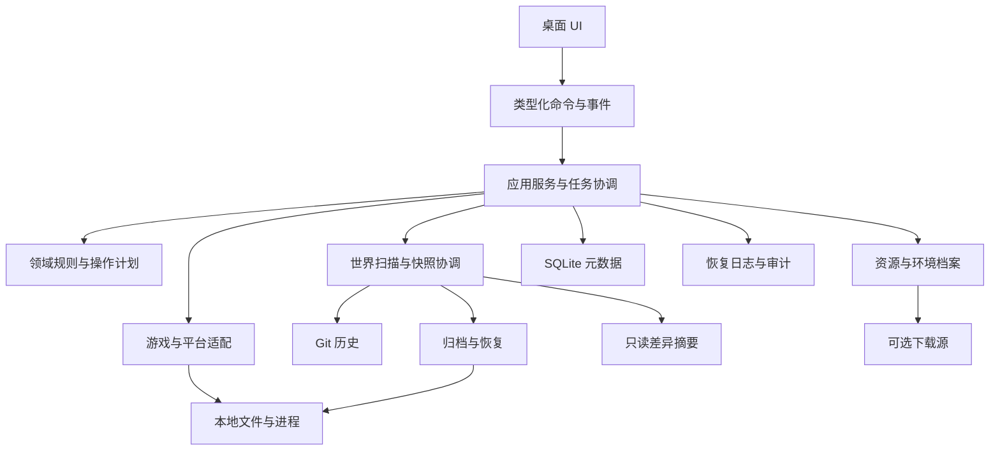

# 系统架构与模块边界

版本：0.1.0 · 日期：2026-10-27 · 状态：待评审 · 责任角色：技术负责人。依据：PRD §14、§16～19。

## 架构目标

采用本地单机应用架构。UI 负责呈现和请求，Rust 应用服务负责策略与任务，基础设施适配文件系统、Git、SQLite 和进程。任何 UI 状态或客户端字段都不能绕过后端恢复前置检查。

Tauri 2、React/TypeScript、SQLite/SQLx、Git CLI、TAR/Zstandard 为 PRD 推荐方案，精确依赖版本和最低系统版本在 M0 技术验证后锁定。本设计不依赖未经核验的框架 API。

## 模块契约

| 模块 | 拥有的规则/数据 | 输入与输出 | 禁止承担 |
|---|---|---|---|
| domain | 世界身份、兼容状态、计划、不变量 | 不依赖平台的值类型与决策 | 文件 IO、框架调用 |
| world-manager | 发现、边界和关联证据 | 根目录句柄+适配器 → 候选与未知项 | 根据名称自动合并角色 |
| save-manager | 静默判断、范围锁、快照协调 | 触发事件 → 独立子任务结果 | 执行任意 shell |
| git-engine | 管理器拥有的世界仓库 | 冻结副本 → 提交/健康报告 | 直接 reset 用户存档 |
| backup-engine | 清单、归档、校验、恢复 | 冻结副本/恢复计划 → 结果 | 依赖 Git 或解析成功 |
| summary-engine | 证据报告与模板 | 前后清单与只读文件 → 文案 | 改变纳入文件或源数据 |
| game-manager/platform | 安装、启动、进程身份、OS 能力 | 导入/启动计划 → 运行证据 | 用 PID 存在等同于同一进程 |
| content/profile-manager | 资源引用、冲突、迁移预检 | 包/档案 → 计划与变更 | 自动承诺跨版本兼容 |
| persistence | 元数据与迁移 | 类型化事务 → 持久记录 | 持有唯一可恢复数据 |
| diagnostics | 审计、错误映射、脱敏导出 | 任务事件 → 本地诊断 | 默认外发或记录存档内容 |

依赖方向为 UI → 应用服务 → domain 与接口 → 基础设施实现。核心模块不能循环依赖；摘要故障不传播为备份故障。共享类型收敛到 domain，禁止模块间绕过接口直接写对方表。

## 文件布局与所有权

| 区域 | 示例逻辑路径 | 所有权与清理 |
|---|---|---|
| 元数据 | workspace/metadata.sqlite | 应用管理，损坏进入受限模式 |
| 世界仓库 | workspace/repos/{world_id}/ | 应用管理；每世界独立；不在玩家目录植入 .git |
| 冻结副本 | workspace/staging/{task_id}/ | 仅带任务归属标记者可回收 |
| 操作日志 | workspace/journal/{task_id}.json | 恢复关键状态，独立于数据库 |
| 备份 | 用户选择目录/{backup_id}/ | 与源分离；支持断开的外置盘 |
| 游戏与存档 | 用户选择的路径 | 用户所有，移除索引不能删除数据 |

以上是逻辑结构，不写死操作系统真实默认目录。源、staging、Git、备份间禁止互为祖先目录；路径别名、软链接、卷 ID 和大小写规则参与重叠判断。源目录内的 .git 或未知文件按原始数据保留，Git 载荷采用安全映射以避免仓库控制文件冲突，见 [检查点设计](../design/checkpoint-and-summary.md)。

## 并发与资源隔离

工作区单写实例；恢复、快照、资源修改、游戏启动都经过同一范围锁服务。锁以规范化真实资源身份建立，世界锁与其根目录锁存在包含冲突；按稳定顺序获取多资源锁避免死锁。外部游戏进程无法被应用锁控制，仍需进程与文件变更检测。

后台 IO 有界并发，初始建议一个重型写任务、两个只读扫描任务；基准测试后校准。任务队列持久化；事件仅为通知，UI 重新连接后通过查询恢复完整状态。取消点、重启和目标替换见 [一致性设计](../design/consistency-and-tasks.md)。

## 故障域和降级

Git 缺失时禁用历史能力，完整备份可用；结构化解析失败时使用文件摘要；网络关闭时保留本地导入启动；SQLite 损坏时停止依赖索引的变更操作，允许独立导入归档并验证至空目录。备份卷脱机显示 unavailable，不能标记已删除。任务结果分别记录 Git/backup/summary 成败，禁止用“部分成功”掩盖用户请求的保护失败。
