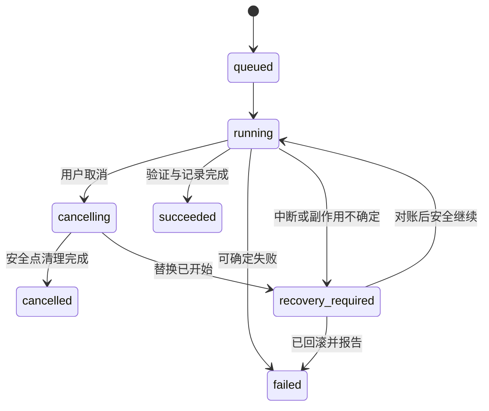

# 一致性、任务状态机与崩溃恢复

版本：0.1.0 · 日期：2026-10-27 · 状态：待评审 · 责任角色：核心服务负责人。需求：APP-003/006、WATCH-001～007、GIT-003、BACKUP-005。

## 独立状态维度

PRD §8.3 的界面流程在实现中拆为三个维度，防止“哈希通过”等同于“游戏一致”。

| 维度 | 值 | 含义 |
|---|---|---|
| task_state | queued / running / cancelling / succeeded / failed / cancelled / recovery_required | 执行生命周期 |
| phase | waiting_quiescence / validating / copying / writing / verifying / protecting / replacing / reconciling | 阶段；只能按操作类型合法迁移 |
| consistency | quiescent_checked / best_effort / unknown | 源数据采集证据 |
| verification | pending / verified / failed | 已生成载荷的完整性 |

`Verified` 界面状态映射为任务完成且 verification=verified，同时单独展示 consistency。best_effort 可以哈希验证通过，但永远不因此升级为 quiescent_checked。

## 自动快照流程

1. 文件事件合并为候选，记录事件序号；监控溢出或失效触发全量重扫并告警。
2. 获取世界/根目录冲突锁；确认管理器启动的进程及可识别外部进程。PID 结合启动时间、可执行文件身份，避免 PID 复用。
3. 游戏运行则等待。退出后等待静默窗口并连续扫描路径、类型、大小、mtime；建议初始窗口 5 秒、采样间隔 1 秒，均为 M0 待校准参数。
4. 根据固定版本适配器建立边界清单。未知共享文件显式列出；边界无法确认时阻止权威世界快照，提供根目录备份计划或用户确认的尽力快照。
5. 复制到任务专属 staging；每个文件读前读后校验身份和元数据，并计算 SHA-256；复制后重新扫描源集合及源内容哈希，与 staging 比对。任何增删改或进程启动使本轮失效，重新等待而非漏掉变化文件。
6. 冻结 staging，只向 Git/归档/摘要消费者提供只读输入；分别完成写入和验证后持久记录。

上述检查降低竞态但不构成操作系统原子快照或游戏语义证明；外部写入可能避开采样。UI 使用“已完成稳定性检查”，不使用“绝对一致”。若平台不能证明退出、权限不足或未知外部运行状态，自动流程等待/失败；手动 best_effort 必须显式标识。

## 转移与取消

写归档/扫描阶段按文件或数据块检查取消；最终发布与恢复重命名区间延迟取消，提示“正在完成安全切换”。不得声称取消成功却继续覆盖目标。清理仅针对记录了 task_id、父目录和所有权标记的临时对象；归属不明则隔离保留。

## 持久化与恢复日志

任务记录含 task_id、request_id、idempotency_key、资源集合、phase、revision、结果、错误码、取消标志、journal_path 和时间。每次外部副作用之前持久化意图，之后持久化观察到的结果；数据库事务与文件系统不是一个原子事务。

恢复 journal 至少包含旧目标、staging、rollback 路径的受信任标识、计划摘要、保护备份 ID、当前阶段、预期内容摘要、前一次阶段。按平台能力同步文件与父目录；持久化保障须做断电/强杀验证，不能仅测试正常关闭。

| 重启发现 | 动作 |
|---|---|
| 只有临时归档 | 保持 unpublished，重新验证或用户取消后清理 |
| 正式归档存在但 DB 无记录 | 校验归档，自描述重建索引，禁止重复覆盖 |
| 旧目标已移到 rollback，新目标尚未到位 | 依 journal 回滚旧目录；路径身份不符则人工处理 |
| 新目标到位但记录未完成 | 核对新目标哈希；通过则补记，否则回滚 |
| 未知目录/日志损坏 | 不猜测、不递归删除，进入 recovery_required |

## 幂等与重试

同一命令的 idempotency_key 与规范化请求摘要唯一关联；重复请求返回原 task_id，不再执行副作用；同键不同内容返回冲突。故障重试生成新 attempt，但沿用父任务关联；覆盖操作必须重新预检和取得新的确认，禁止自动重放过期计划。

短暂权限/网络/文件变化可有限退避；磁盘不足、未知边界、校验失败不可忙重试。默认等待上限、重试次数在设置及测试记录中明确；初始建议最多 3 次复制重试，超出后保留明确失败原因。
