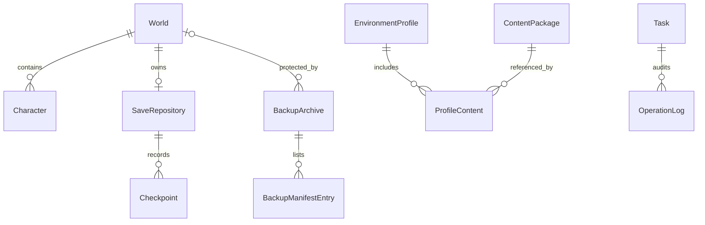

# 数据模型、持久化与迁移规范

版本：0.1.0 · 日期：2026-10-27 · 状态：待评审 · 责任角色：持久化负责人。依据：PRD §14、APP-006、WORLD-002/006、BACKUP-003。

## 通用约定

实体 ID 使用不依赖名称或路径的随机 UUID；时间存 UTC RFC3339，界面本地化。路径显示文本与 OS 原生路径编码分离；SQLite 可保存原生路径字节及平台标识，跨平台导出只使用可验证的相对 UTF-8 路径。大小为非负 64 位整数；IPC/JSON 的字节数和其他可能超过安全整数的量以十进制字符串传递。

各表含 created_at、updated_at；可变聚合含 revision 乐观锁。外键启用、删除默认 RESTRICT。用户移除管理引用只置 archived_at，不级联删除文件。身份置信度采用 confirmed / probable / unknown，并记录 evidence_source，避免无依据的精确百分比。

## 实体与约束

| 实体/建议表 | 关键字段 | 关系、索引及不变量 |
|---|---|---|
| Workspace | id, schema_version, status | 工作区单写；路径通过 PathBinding 管理 |
| PathBinding | id, native_path, platform, volume_id, file_identity, kind | 真实身份去重；每次写前重验，显示名不作为权限凭证 |
| GameInstallation | id, path_id, branch, version?, platform, arch, executable_ref, source, checksum?, status | 引用路径受控；unknown 显式表示，不能默认某版本 |
| GameRelease | id, source_url, version, channel, asset_url, size, digest?, digest_source?, fetched_at | 来源+资产唯一；计算摘要与上游可信摘要分别存储 |
| World | id, save_root_id, path_id, alias, notes, importance, category, confidence, last_install_id? | 按 root/status 索引；同名允许；路径迁移保留身份需证据 |
| WorldTag | world_id, tag | 联合唯一；标签更名不改世界身份 |
| Character | id, world_id?, display_name, identity_key?, confidence, evidence | 仅可靠 identity_key 在同一世界内去重；显示名不唯一 |
| BoundaryRevision | id, world_id?, adapter_version, scope, manifest_hash, unknown_entries | 快照引用不可变边界版本 |
| ContentPackage | id, type, version?, source?, license?, checksum, path_id, compatibility | 类型为 mod/soundpack/tileset/font；兼容状态须带证据 |
| EnvironmentProfile | id, schema_version, name, install_id?, revision, exported_metadata | 导出档案不以本机 ID 作为可移植身份 |
| ProfileContent / ProfileConfig | profile_id, package_id/config_ref, role, order, enabled, digest? | 组合顺序保留；删除前检查引用 |
| SaveRepository | id, world_id, path_id, status, last_verified_commit? | world_id 唯一；不对源目录初始化 |
| Checkpoint | id, world_id, repository_id, commit_hash, parent_hash?, boundary_id, consistency, verification, report_id? | repo+commit 唯一；提交哈希不写死长度 |
| BackupArchive | id, scope, world_id?, path_id, format_version, manifest_hash, archive_hash?, consistency, verification, verified_at?, locked, purpose | scope=world 时 world_id 必填；root 时可空；删除另有墓碑记录 |
| BackupManifestEntry | backup_id, relative_path, type, size, sha256?, mtime? | backup_id+路径唯一；归档内清单才是独立恢复依据 |
| DiffReport | id, checkpoint_id?, parser_version?, facts, inferences, unknowns, evidence | 不可变；用户文案单独记录 |
| PlaySession | id, install_id, world_id?, process_identity, started_at, ended_at?, duration? | 功能关闭时仍允许运行监测，但不保留游玩统计 |
| Task / TaskAttempt | id, type, state, phase, revision, idempotency_key, request_digest, result, error | key 唯一；重试 attempt 关联原任务；状态机校验 |
| OperationPlan | id, kind, target_refs, target_fingerprint, source_digest, expires_at, plan_digest | 确认绑定不可变计划，变化即失效 |
| OperationLog | id, task_id, action, target_token, status, error_code, timestamp | task/time 索引；追加记录；无原始内容 |
| AppSettings | key, schema_version, value, updated_at | 设置按类型校验；凭证不能进入此表 |

## 事务边界

数据库提交只保护元数据。外部写入按意图日志→副作用→结果对账模式，禁止长 SQL 事务包住哈希/压缩。发布归档后 DB 写失败，下一次从归档和 journal 重建；不能删掉已验证归档以“回滚数据库”。

索引分页使用稳定的时间+ID 游标，不在 UI 线程做全清单查询。完整文件清单可流式访问；性能测试覆盖百万条目场景时先评估 DB 体积和查询成本，测试规模为工程压力目标，不是首发承诺。

## Schema 迁移

启动：取得工作区独占锁 → 检查版本与数据库完整性 → 使用一致性备份机制保存 DB（包括正确处理 WAL）→ 顺序执行带校验和的迁移 → 验证外键与关键不变量 → 更新 schema version → 开放写操作。迁移脚本不可原地改写，修改用新迁移。

迁移失败恢复元数据备份，记录 migration_failed，保留诊断，绝不变动源存档。旧应用发现高版本 schema 进入只读或拒绝打开，不能强行降级；回退须同时选择匹配旧 schema 的元数据副本。需要长时间数据重建的迁移采用新库构建后受控切换。

## 数据库灾难恢复

优先恢复最近一致性元数据备份；无法恢复时建立新工作区，扫描用户指定安装/存档/归档，按清单 ID 和证据重建索引，身份冲突需人工绑定。别名、标签和部分会话记录可能丢失，应在诊断中说明；原始世界和独立备份仍可使用。禁止通过数据库缺失推导“磁盘文件可清理”。

## 当前实现：schema 5 检查记录

实际迁移链位于 crates/hub-core/src/migration-002.sql 至 migration-005.sql。schema 5 追加 inspection_task，不改写原 restore_task：随机 id、唯一 request_key、request_digest、restore_task_id 外键、state、phase、revision、error_code、UTC created_at/finished_at 与可空 result_json。结果仅含摘要、计数、时间和标记存在状态；长度限制 64 KiB，不保存存档内容。原任务历史结论与新的检查结果保持独立。

检查任务和审计意图、终态和结果分别按事务提交；取消或失败不产生新的通过结果。重启将遗留活动检查标为 recovery_required/TASK_INTERRUPTED，并清空未完成结果。结果无法解码或成功记录缺少结果时返回 INSPECTION_RESULT_INVALID，不填充默认值。所有工作区写任务与长时间检查互斥，运行时结束事实用于处理终态持久化失败。

schema 1～4 打开前创建 VACUUM 一致性副本、quick_check 与持久化文件，再事务升级到 5；升级失败保留旧版本。此为当前实现说明，不表示本文件设计中的 world identity、journal、环境档案或全量生产任务模型都已经实现。

## 当前实现：schema 6 备份标注（2026-10-28）

backup_archive 新增 display_name / notes（默认空）、retention_locked（默认 false）、metadata_revision（默认 0，限制为 JS 安全整数范围）与 metadata_updated_at（默认 null）。这些字段不纳入原始归档格式，不改变独立恢复的数据库无关性。更新使用预期修订比较与事务审计，内容相同的请求不重复推进版本，审计失败回滚全部变更。升级前创建 schema 1～5 的一致性副本；ALTER 失败整体回滚。详情见 [标注设计](backup-details-implementation.md)。

## 当前实现补充：schema 7 游玩实例（2026-10-28）

`play_instance(id, installation_id, installation_sha256, name, data_root, binding_status, created_at)`；安装外键、目录唯一、绑定状态固定 `unverified`。单安装多实例，实例登记尚不构成实际目录绑定。详细不变量与迁移见 [实例登记](play-instance-registration.md)。

## 当前实现补充：schema 8 实例会话（2026-10-28）

session 增加可空 play_instance_id（外键）、launch_profile_id、instance_data_root。旧会话为空；实例会话记录当次方案和数据根，重启未知保留这些字段，不用退出结果反填实例绑定已验证。实现见 [实例试运行](instance-launch-trial.md)。

## 当前实现补充：活动资源占用投影（schema 8 不变）

`ResourceClaim` 通过 SQL 从现有持久所有者状态派生，不新增租约表。字段为 owner_kind、owner_id、operation、state、scope、access、path?、reason。所有活动所有者当前均有全局独占声明，并附已知目录用途；终态事务自动移除投影中的占用，重启未知会话继续保留。该投影不是完整写入边界验证，也不授权按目录并发。见 [资源占用设计](resource-ownership.md)。

## 当前实现补充：实例备份来源（schema 9）

backup_task 与 backup_archive 各新增 nullable play_instance_id（引用 play_instance）、source_root。旧记录为 null，保持历史，不通过当前目录推断来源。新计划及任务由服务端记录实际源根；归档保存实例关联，独立清单 v2 带登记安装身份快照。恢复不自动绑定实例，保留预览不混合不同实例范围。见 [来源与迁移契约](instance-backup.md)。

## Schema 10：持久安装复制

新增 installation_copy_task，保留 request_key（唯一）、request_digest、source_installation_id 外键、来源/目标路径、程序与原始清单 SHA、copy_id/payload_root、条目/文件/链接计数、字节字符串、状态/阶段/进度/revision、错误与完成/核验时间，以及可选 registered_installation_id 外键。destination 唯一。安装登记、任务关联和两类审计同事务提交。升级前保存 schema 9 快照；迁移失败回滚。重启不重放复制，将活动任务标记 recovery_required。完整字段约束以 migration-010.sql 为准。
